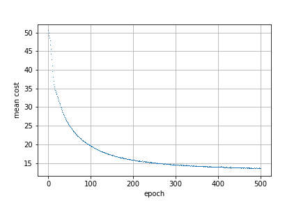
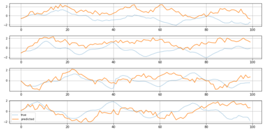

# Conditional Restricted Boltzmann Machine

We forked this code from the [gist code](https://gist.github.com/gwtaylor/2505670) implemented by G.W. Taylor.

## Figures

[^Taylor2006]: G.W. Taylor, G.E. Hinton, and S. Roweis, *Modeling Human MotionUsing Binary Latent Variables*, **NIPS**, 2006.
[^Taylor2009]: G.W. Taylor and G.E. Hinton, *Factored Conditional Restricted Boltzmann Machines for Modeling Motion Style*, **ICML**, 2009.
